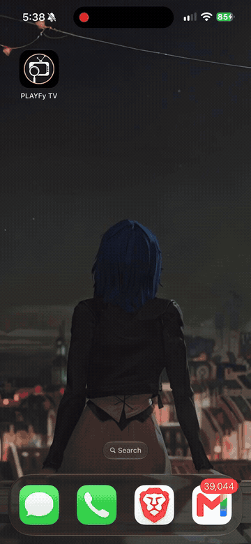

# PLAYFy on iOS with Husk + PiP

Run **PLAYFy TV on your iPhone through Husk in LiveContainer**, with native **video-only Picture in Picture** so the livestream keeps playing while you use other apps. This is an unofficial, modified Husk 3.1 build, tested with PLAYFy v1.7.

**[Download the Husk IPA](../../releases/latest)** · **[Download PLAYFy APK](https://playfy.net/#dl)** · **[Setup](docs/INSTALL.md)** · **[Features](docs/FEATURES.md)**

**New: [v0.2.0 App Clip test build](https://github.com/0RageQuit/Husk-Video-PiP/releases/tag/v0.2.0)** fixes Husk's built-in **Generate App Clip** output for LiveContainer. [Add a Home Screen icon](docs/APP_CLIPS.md). The new shortcut path is awaiting phone validation. This is now the only published release; the older release without App Clip support has been removed.

The floating window contains decoded video and iOS playback controls, rather than a capture of the Android app's menus or the whole LiveContainer window. This is a Husk compatibility build, not a native iOS port of PLAYFy or CRICFy.

## Demo

[Watch or download the full MP4 demo](https://github.com/0RageQuit/Husk-Video-PiP/raw/refs/heads/main/docs/media/PLAYFy-demo.mp4).

## How it makes PLAYFy work with PiP

Husk provides the Android compatibility layer that runs PLAYFy's original APK on iOS. This build connects Husk's decoded video frames to Apple's native PiP system and keeps the video/audio path running when the host interface is backgrounded. It also includes playback-related fixes for orientation, changing frame sizes and reopening apps.

**LiveContainer → modified Husk → original PLAYFy APK → native iOS video PiP**

Install the custom Husk IPA, import PLAYFy's APK, start a livestream and tap the added PiP icon. PLAYFy's APK stays unchanged; you do not convert it into an IPA. The APK is downloaded separately from [PLAYFy's download page](https://playfy.net/#dl), not hosted in this repository. [Build instructions and source](docs/BUILD.md) are also included.

## Setup

1. [Download the Husk IPA](https://github.com/0RageQuit/Husk-Video-PiP/releases/latest) and install it in **LiveContainer**.
2. Install [StikDebug](https://github.com/StikDebug/StikDebug/releases/latest), import your device's [pairing file](https://github.com/StikDebug/StikDebug-Guide/blob/main/pairing_file.md), and enable **LocalDevVPN** as described in [StikDebug's setup guide](https://github.com/StikDebug/StikDebug#how-to-enable-jit).
3. In **LiveContainer → Settings → JIT**, select **StikDebug** as the JIT enabler.
4. In LiveContainer, **hold Husk → Settings**, enable **Launch with JIT**, then use **JIT Launch Script** to select **`universal.js`**. **`universal.js` should already be present in StikDebug’s Scripts after setup.** Save/export that script to Files, then select it here. This is the setting for **Husk inside LiveContainer**, not PLAYFy's Android settings. On the tested iOS 27 setup, selecting this script is required; enabling JIT alone is not enough.
5. Launch Husk from LiveContainer and let StikDebug complete the JIT attachment. Keep LocalDevVPN connected during this process.
6. [Download PLAYFy APK](https://playfy.net/#dl), rename the file to **`com.playfy.tv.apk`**, then import it into Husk.
7. Open PLAYFy, play a stream and tap the **PiP icon** to watch while using other apps.

The PiP icon hides after three seconds. Tap the screen to show it again.

## Add an App Clip

With the v0.2.0 test build, open your PLAYFy entry's **Husk settings → Home Screen → Generate App Clip**, then install the generated profile in iOS Settings. Husk fills in the current app IDs and LiveContainer route automatically. [Full instructions](docs/APP_CLIPS.md).

## Features

- Native video-only PiP with bounded frame ownership.
- Player-requested fullscreen/orientation while keeping portrait menus.
- Correct per-frame dimensions during video resolution changes.
- Original APK mapping/signature validation retained; no APK patching.
- Preference parsing fix for reopening apps after the first run.
- Icon-only PiP control, moved left, with tap-to-show and three-second auto-hide.
- Video-readiness checks and limited retries for the observed cold-start error.
- Playback pause separated from Android activity pause; reconnect request on resume.
- Optional, per-import CRICFy banner/fallback filtering and removal of the obsolete v7.3 update notice, preserving saved original values.

[Feature details and limitations](docs/FEATURES.md).

## Tested scope and known issue

The test device is an **iPhone 16 Plus on iOS 27.0.1**, using LiveContainer. The latest IPA was reported working. PiP playback, fullscreen, background recovery and channel switching were reported working; PLAYFy was more stable during longer pauses.

**CRICFy's paused PiP window can still disappear after roughly a minute in the background. This remains unresolved.** Other devices, apps, streams and codecs are not universally verified. WebView-only and external players may not use the video path covered here.

See [Testing](docs/TESTING.md) and [Troubleshooting](docs/TROUBLESHOOTING.md). PC tests do not substitute for iPhone playback validation.

## Source and credits

Husk is by **[Leviidev and contributors](https://github.com/Leviidev/Husk)**. This build is based on [Husk 3.1](https://github.com/Leviidev/Husk/tree/3.1), commit `7cc583ce3fccd271eea9087483ddc5e49af14d8d`. It is unofficial and is not endorsed by upstream.

The complete pinned upstream source archive, modified Java classes, native hooks, PiP module, build scripts and license texts are included. Husk and these changes are **GPL-2.0-or-later**. The signing helper comes from **[NXNativeWindows](https://github.com/zenvyzenshiro/NXNativeWindows)** under its included MIT license. See [NOTICE](NOTICE.md) and [LICENSE](LICENSE).

No APKs, stream lists, credentials, device backups, Apple SDKs or signing identities are included.
